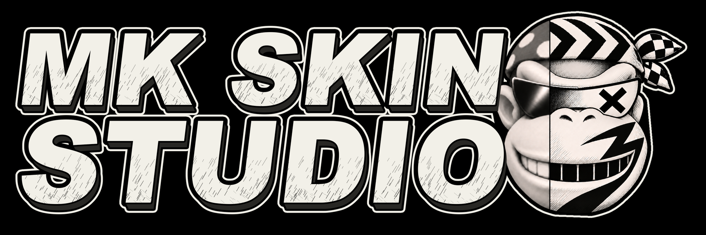

<p align="center">
  
</p>

<p align="center">
  <a href="https://github.com/karps-games/mk-skin-studio/releases/latest"></a>
  <a href="https://github.com/karps-games/mk-skin-studio/releases"></a>
  <a href="https://discord.gg/93vfR7597T"></a>
</p>

<p align="center">MK Skin Studio by Karps Games is licensed under GNU General Public License v3.0</p>

# MK Skin Studio

## Skin studio for Mario Kart Wii characters

MK Skin Studio lets you paint Mario Kart Wii characters right on the 3D model, with layers, recolors and a live preview. Kart and bike outfits can be painted separately, and the low detail models other players see during a race follow your edits.

Each project is a mod: pick the characters, paint them, and export everything as one `.zip`. It works on its own with any loader that accepts `.zip` mods, and the export installs directly in MK Launcher.

## Requirements

You need your own, legally dumped copy of Mario Kart Wii. Any region works.

Accepted formats: `.iso`, `.wbfs`, `.rvz`, `.wia`, or an extracted game folder.

MK Skin Studio does not include or download any Nintendo files.

## Download

Get the latest version from the [releases page](https://github.com/karps-games/mk-skin-studio/releases/latest).

- **Windows 10/11:** run the `x64-setup.exe` installer.
- **macOS (Apple Silicon and Intel):** open the `.dmg` and drag the app to Applications. The app is not signed yet, so the first time right-click it and choose Open, or go to System Settings > Privacy & Security and click Open Anyway.
- **Linux:** use the `.AppImage` (`chmod +x`, then run it) or install the `.deb`. Needs WebKitGTK 4.1 (Ubuntu 22.04+, Debian 12+, Fedora 38+).

## Antivirus and SmartScreen

The builds are not code signed yet. Windows SmartScreen may show "Windows protected your PC" (click More info > Run anyway), and some antivirus programs may flag the installer. These are false positives. You can check the file on [VirusTotal](https://www.virustotal.com) or build it yourself from source.

## Building from source

You need [Node.js](https://nodejs.org) 22.12 or newer and [Rust](https://rustup.rs) (stable).

- **Windows:** Visual Studio Build Tools with the "Desktop development with C++" workload.
- **macOS:** Xcode Command Line Tools (`xcode-select --install`).
- **Linux (Debian/Ubuntu):** `sudo apt install build-essential libwebkit2gtk-4.1-dev libxdo-dev libssl-dev libayatana-appindicator3-dev librsvg2-dev clang`

```sh
npm ci
npm run tauri dev
npm run tauri build
```

`tauri dev` runs the app with hot reload. `tauri build` creates the executable in `src-tauri/target/release`.

## Contributing

Bug reports, translations and pull requests are welcome. See [CONTRIBUTING.md](CONTRIBUTING.md).

## Support

Questions, bugs and ideas go to our [Discord](https://discord.gg/93vfR7597T). If you want to support the project, you can do it on [Ko-fi](https://ko-fi.com/m1t5).

## License

MK Skin Studio is free software under the [GNU General Public License v3.0](LICENSE) or later.
You can use, study, share and change it under the same terms.

## Credits

- [gctex](https://crates.io/crates/gctex) by riidefi (GPL-2.0-or-later): GameCube/Wii texture encoding and decoding
- [szs](https://crates.io/crates/szs) by riidefi (MIT): Yaz0 compression
- [nod](https://github.com/encounter/nod) by encounter (MIT or Apache-2.0): disc image reading
- [three.js](https://threejs.org) (MIT): 3D preview
- [Tauri](https://tauri.app) (MIT or Apache-2.0): app framework
- File format notes from [wiki.tockdom.com](https://wiki.tockdom.com)

Not affiliated with Nintendo. Mario Kart and Wii are trademarks of Nintendo.
